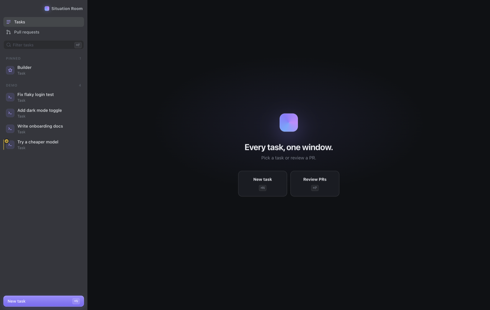
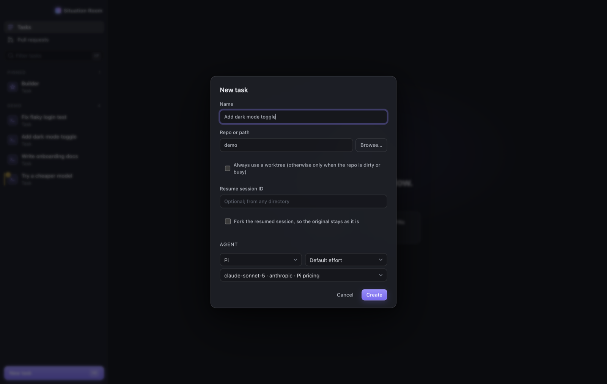
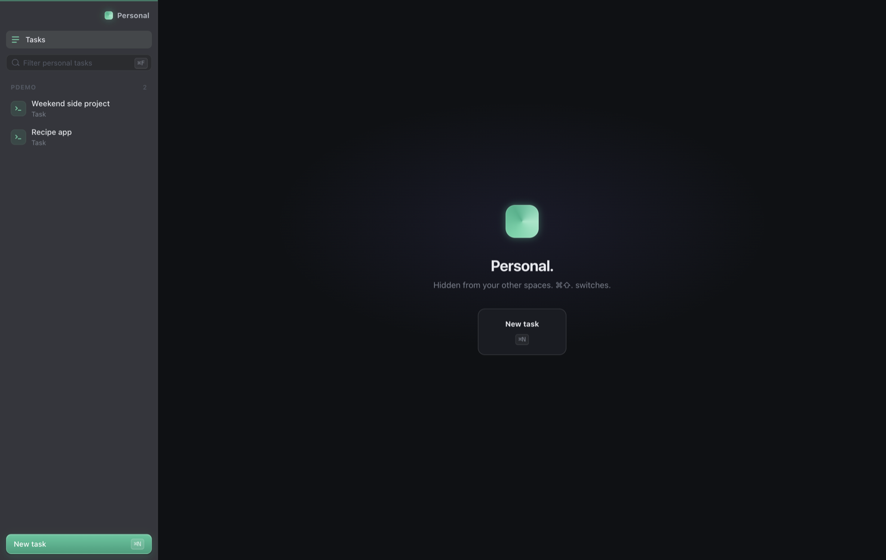

# Situation Room

Run many AI coding agents side by side on your Mac, one task per tab, each in its own branch or worktree.

Situation Room is a desktop app for [Claude Code](https://code.claude.com) and [Pi](https://github.com/earendil-works/pi). Pick an agent and a model for each task, watch every session's status in one sidebar, review pull requests and draft fixes, and see what each model costs you.



## Features

- **Tasks side by side.** Each task is a full terminal session. The sidebar shows which ones are working, waiting for you, or done.
- **Branches handled for you.** A new task branches off `origin/main` in your repo, or in a worktree beside it when the checkout is busy. Removing the task cleans up the worktree.
- **Claude Code or Pi, per task.** Choose the harness, model and effort when you start. Pi lets you switch models mid-task.
- **Pull requests.** Read a PR's description, line comments (with the code they point at) and conversation. Review it in its own worktree; the agent drafts comments, you edit and submit them. To change someone else's PR, click **Contribute** in the review: the agent can then edit its branch and Ship pushes your commits to it. On your own PRs, the agent works through review threads and drafts replies.
- **Ship.** Drafts commits and a draft PR from your changes, assigned to you and labelled with the repo's own label for the kind of change (bug fix, feature, …), which you can change. It only types the commands; you press Enter.
- **Usage.** Tokens and cost per session, per model and per harness, with a what-if against a single model (⌘U).
- **Spaces.** Keep personal projects out of your work view, with their own Claude login (⌘⇧.).
- **Jira** (optional). Browse tickets and start a task from one.
- **Debug tasks.** Paste a Slack report or an error; the agent searches your logs in Kibana, finds the cause in the code, and fixes it on a fresh branch off main.
- **Task menu.** Right-click a task to pin it, rename it, fork its session into a new task, copy its session ID, branch or folder, restart its agent, or remove it.



## Requirements

- macOS
- [Node.js](https://nodejs.org) 20 or later
- [Claude Code](https://code.claude.com/docs/en/setup), signed in (`claude` then `/login`), or set up with an API key or gateway
- [GitHub CLI](https://cli.github.com), signed in with `gh auth login`, for pull requests and cloning
- git

Pi is installed with the app; you don't need it separately.

## Install and run

```bash
git clone https://github.com/<you>/situation-room.git
cd situation-room
npm install
npm start
```

The app starts a background daemon that owns the sessions, so quitting the window leaves your tasks running. View → Restart Daemon restarts it; sessions resume.

## Configure

Settings live in `~/.situation-room/config.json`. Copy [`config.example.json`](config.example.json) and keep only what you need:

| Key | What it does |
|---|---|
| `roots` | Folders that hold your repos. New task lists the repos in them. Default `~/code`. |
| `org` | GitHub org used to clone a repo you name but don't have yet. |
| `prRepos` | Repos whose open PRs the Pull requests tab lists (`owner/name`). You can also add them in the app. |
| `spaces` | Extra spaces such as Personal. See [Spaces](#spaces). |
| `pi` | `mode` and default `model` for Pi. See [Pi](#pi). |
| `gateway` | An LLM gateway such as LiteLLM. Leave it out to talk to providers directly. |
| `jira` | Your Jira site. Leave it out and the Jira tab stays hidden. |
| `builderSpace` | The space the Builder task lives in, such as `personal`. Default: work. |
| `debug`, `logs` | Projects you can debug, and where their logs are. See [Debug tasks](#debug-tasks). |

Restart the daemon after editing the file.

## Pi

Pi works in one of two ways.

**Native (default).** Pi signs in to providers itself. Start a Pi task and type `/login` to sign in with Anthropic, OpenAI, GitHub Copilot and others, or export an API key before starting the app:

```bash
export ANTHROPIC_API_KEY=sk-ant-...      # or OPENAI_API_KEY, OPENROUTER_API_KEY, GEMINI_API_KEY, …
npm start
```

The model picker lists whatever Pi can reach with those credentials. Pick one to make it the default with `"pi": { "model": "anthropic/claude-sonnet-5" }`.

**Through a gateway.** If your team runs [LiteLLM](https://docs.litellm.ai) or a similar proxy, add a `gateway` section. Both Claude Code and Pi then use the gateway's models, and prices come from the gateway:

```json
"gateway": {
  "url": "https://llm-gateway.example.com",
  "keyFrom": "claude-settings",
  "models": "gateway-models.json"
}
```

- `keyFrom`: `claude-settings` reuses the `ANTHROPIC_AUTH_TOKEN` from `~/.claude/settings.json`; `env:NAME` reads an environment variable.
- `models`: the gateway's model list, relative to `~/.situation-room/` unless absolute. See [`gateway-models.example.json`](gateway-models.example.json). `base` maps a gateway model to Anthropic's own name, so Claude Code can use it too.

Claude Code itself goes through the gateway only if you set it up that way in `~/.claude/settings.json`.

## Spaces

A space is a separate list of tasks with its own project folders. The default config has one called **Personal**:

```json
"spaces": {
  "personal": { "label": "Personal", "roots": ["~/personal"], "claudeConfigDir": "~/.claude-personal" }
}
```

- **Switch** with ⌘⇧. (Command, Shift and the full stop). The sidebar title turns green and shows the space's name. Press it again to cycle back.
- **Separate.** Tasks only appear in their own space. Notifications from another space say "A task needs you" without the task name, and the dock badge counts only the current space. Pull requests and Jira stay in the work view.
- **Own Claude login.** With `claudeConfigDir` set, Claude Code in that space uses its own config folder and its own login, and never your gateway. Sign in once: open a task in the space and type `/login`, then pick your personal claude.ai account. Your `~/.claude/CLAUDE.md` is linked in; skills and plugins are not.
- **Usage** counts login sessions as subscription tokens, with no per-token cost.

- **Work on main** (`"allowMain": true` on a space): New task shows a **Work on main** box. The task runs in the repo's own checkout on its default branch, with no branch or worktree, and Ship commits, rebases onto the latest and pushes straight to it, with no pull request. Spaces without `allowMain`, and the work view, never offer it; the daemon refuses it there too.

Pi isn't offered in a space with its own Claude login. Remove `claudeConfigDir` to use your normal setup there.



## Debug tasks

**New task → Debug** (or **+** on the Debug section) starts a debug task for one incident, on any repo: pick it as for a normal task (or Browse), paste what happened (a Slack thread, an alert, an error), and pick the agent. It gets its own worktree and branch off the latest `origin/main`, and the agent starts with a debugging guide:
1. investigate: logs first, then the code that logged the error;
2. report the cause with evidence and a planned fix, then wait for your go-ahead;
3. fix on its branch and run the repo's tests;
4. you ship it as a draft PR from the Ship tab.

Optional per-repo settings in `config.json` make the agent faster at a repo you debug often:

```json
"logs": { "url": "https://kibana.example.com" },
"debug": {
  "my-service": { "repo": "my-service", "namespace": "my-namespace", "notes": "docs/debugging.md" }
}
```

- `repo`: the repo's folder name, or an absolute path; matched against the repo you pick.
- `namespace`: the Kubernetes namespace its logs are in; the default for log searches.
- `notes`: a Markdown file about the repo, appended to the guide: where it runs, the log events that matter, traps. Relative to the repo, or absolute.
- `index`: the Elasticsearch index pattern, default `filebeat-*`.

Put the Kibana API key in `.env` in the app folder:

```
SR_LOGS_API_KEY=...
```

The agent searches with `sr-logs`, which comes with the app (`sr-logs --help`): read-only, through Kibana's console proxy, errors only by default. The generic guide is `prompts/debug.md`; edit it to change how every debug task works.

## Jira

```json
"jira": { "base": "https://your-site.atlassian.net", "defaultProject": "ABC", "repos": { "ABC": "some-repo" }, "team": ["ABC"] }
```

Put your credentials in a `.env` file in the app folder (it is gitignored):

```
JIRA_USERNAME=you@example.com
JIRA_API_TOKEN=...
```

Starting a task from a ticket assigns it to you and moves it to In Progress, asking first if someone else holds it. New tickets are drafted for you and only created when you confirm.

## Keyboard

| Keys | Action |
|---|---|
| ⌘N | New task |
| ⌘K | Jump to a task, PR, ticket or action |
| ⌘1–9 | Open task 1–9 |
| ⌘↑ / ⌘↓ | Previous / next task |
| ⌘⇧1 / 2 / 3 | Agent / Shell / Changes tab |
| ⌘E | Toggle the side panel |
| ⌘T / ⌘P / ⌘J | Tasks / Pull requests / Jira |
| ⌘U | Usage breakdown |
| ⌘⇧. | Switch space |
| ⌘F | Filter tasks |
| ⌘B | Hide / show the sidebar (drag its edge to resize, double-click to reset) |

Click a section heading in the sidebar to collapse it; that's remembered.

## Where things live

| Path | Contents |
|---|---|
| `~/.situation-room/config.json` | Your settings |
| `~/.situation-room/state.json` | Tasks |
| `~/.situation-room/reviews/` | Review, reply and Ship drafts |
| `~/.situation-room/pi-sessions/` | Pi conversations |
| `~/.claude/projects/` | Claude Code conversations (Claude Code's own) |

Nothing is sent anywhere except to the model providers and to GitHub or Jira when you submit something yourself.

## Hacking on it

The Builder task, pinned at the top, is an agent session inside this repo; ask it to change the app. [`CLAUDE.md`](CLAUDE.md) explains the layout. Edits under `ui/` reload the window; edits to `daemon.js` need View → Restart Daemon. Plain JavaScript, no build step.

## License

[MIT](LICENSE)
